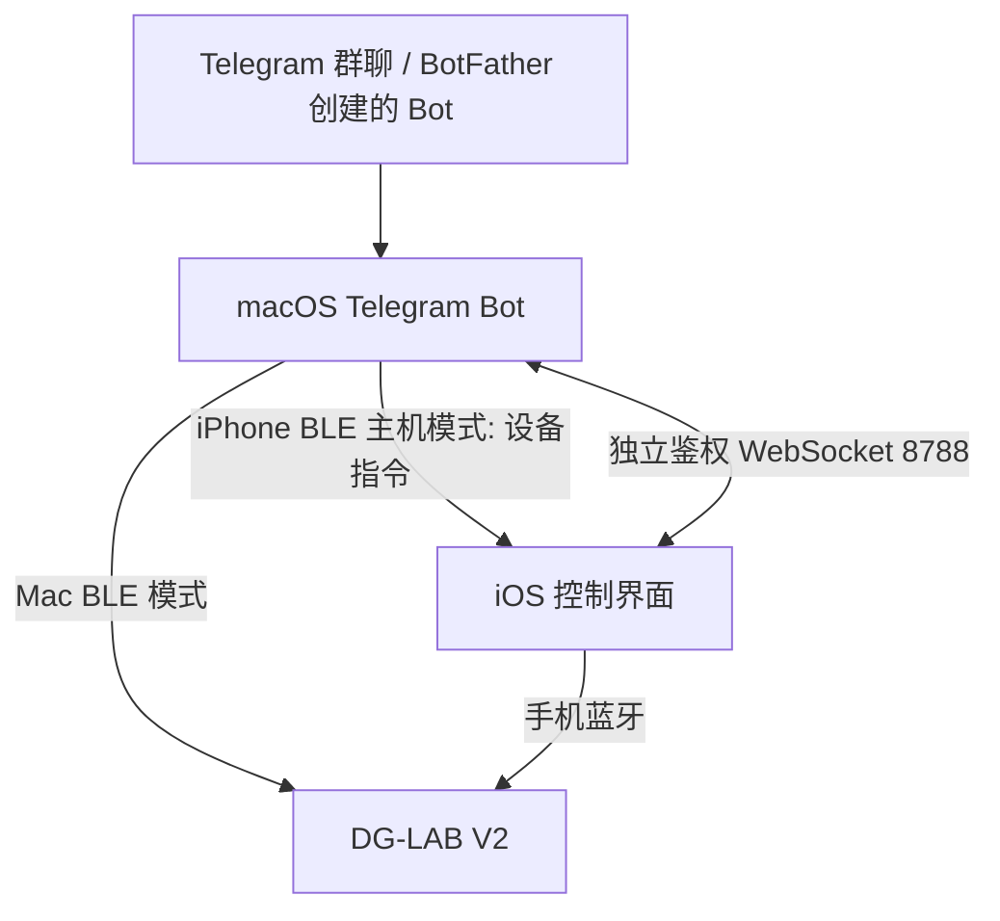

# DG-LAB Control for iOS

[中文](README.md) · **Unofficial / community-developed** · [Companion Telegram Bot](https://github.com/shzxm/dglab-telegram-bot) · [MIT License](LICENSE)

使用 **SwiftUI + CoreBluetooth** 开发的 DG-LAB V2（`ESTIM01`）iPhone / iPad 控制端。既可在手机上独立连接蓝牙，也可以通过**独立鉴权 WebSocket 桥接**与 macOS 上运行的 Telegram Bot 协作。**无需上架 App Store，可自行使用 Xcode 签名安装。**

> **实验性项目，不是 DG-LAB 官方 App。** 当前代码已通过 iOS 27.2 SDK 的模拟器 Debug 和 iPhoneOS ARM64 Release 构建及核心单元测试，但 **真实 iPhone 蓝牙、声音权限、前后台切换与紧急停止尚未完成实体设备验收**。模拟器无法替代电刺激设备测试。软件强度最大值 `133` 仅是协议/程序取值范围，不代表人体安全阈值。请确保实体硬件有可立即触及的独立停止或断开方式。

## 功能

| 模块 | 当前实现 |
|---|---|
| 连接 | CoreBluetooth 扫描 DG-LAB V2、连接/断开、读取电量；默认不授权输出 |
| 通道 | A/B 独立强度、±1 / ±3 / ±5、现场授权、双通道停止及归零 |
| 波形 | 3 组基础波形 + 6 组导入波形；A/B 独立选取、循环发送 |
| 自动提升 | A/B 独立开关；**1–60 秒**长滑杆设置提升间隔；累计自动 **+1 至 +33 级**后停止，或提前达到通道上限 |
| 声音响应 | 音量响应与节拍响应可单独/同时启用；麦克风、App 内音频文件、受控桥接的 MBP RMS 数值 |
| 频率 | 固定 1 / 20 / 50 / 100 Hz、5–15 / 10–30 / 20–50 / 1–100 Hz；额外支持 **1–100 Hz 双手柄自定义区间**，例如 5–88 Hz |
| Telegram | 管理员/投票/活动面板、邀请码、群绑定、临时操作员、随机抽选、动作池、会话状态和 OBS 链接入口，通过配套 Bot 实现 |
| 安全性 | A/B 默认本地上限 0、会话限时、桥接密钥存 Keychain、软件尝试停止/归零 |

自动提升的“+N”表示**本轮由自动提升实际完成的 N 次 +1**，不是目标强度绝对值。更改间隔不会清零当前累计数；手动增减强度不计入自动提升次数；如果先碰到本地通道上限，会提前停止。停止自动提升不会自动降低当前强度。

节拍设置使用的是 DG-LAB 波形周期频率，**不是音频音调、Z 参数或实际电流强度**。双手柄从同一轨道上调整最低/最高 Hz，松手后再提交至桥接服务以避免大量命令。

## 三种使用方式

| iOS 工作模式 | 蓝牙连接者 | Telegram Bot 是否必需 | 工作关系 |
|---|---|---|---|
| **iPhone 独立控制** | iPhone | 不需要 | 本机完成现场授权、波形与强度控制 |
| **远程控制现有 Bot** | Mac (`DG_DEVICE_MODE=ble`) | 需要 | iPhone 仅作管理控制面板，Bot 负责会话、Telegram 权限和 Mac 蓝牙 |
| **iPhone 作为蓝牙主机** | iPhone (`DG_DEVICE_MODE=ios`) | 需要 | Bot 负责 Telegram 多人会话，iPhone 通过 WebSocket 接收设备命令；首次必须在手机本地批准 |

**同一台 DG-LAB 设备不能同时被 Mac 与 iPhone 蓝牙占用。** 独立模式不需要 Bot；另两种模式必须运行 [dglab-telegram-bot](https://github.com/shzxm/dglab-telegram-bot)。架构和权限划分见 [docs/ARCHITECTURE.md](docs/ARCHITECTURE.md)，协议见 [docs/BRIDGE.md](docs/BRIDGE.md)。

## 运行要求

- **Xcode 27.2** 或与工程兼容的更新版本，iOS 27.2 SDK（工程部署目标为 iOS 27）；可使用自有 Apple Developer Team 签名，**不需上架**。
- iPhone / iPad，具备蓝牙权限。Duo 布局使用 SwiftUI 自适应界面，但 **尚未完成 Duo 专项真机验收**。
- 独立模式：支持的 DG-LAB V2 蓝牙设备。
- Telegram 协同：一台运行配套 Bot 的 macOS 电脑、局域网或安全 WSS 网络、独立桥接密钥；iPhone 与 Mac 使用同一协议版本。

### 克隆与编译

```bash
git clone https://github.com/shzxm/dglab-ios.git
cd dglab-ios
# XcodeGen 仅在重新生成 .xcodeproj 时才需要
brew install xcodegen
xcodegen generate --spec project.yml
open DGLabControl.xcodeproj
```

Xcode 选择 **DGLabControl → Signing & Capabilities → Team**，配置自己的 Apple 开发者团队。默认 Bundle Identifier 为 `com.shzxm.DGLabControl`；其他开发者请修改 `project.yml` 中的标识并重新运行 XcodeGen。连接打开开发者模式的 iPhone 后，选择设备运行。不要把 `.p12`、`.mobileprovision`、Apple 账号资料或签名配置提交到仓库。

命令行模拟器/设备构建（无需签名）：

```bash
xcodebuild -project DGLabControl.xcodeproj -scheme DGLabControl \
  -configuration Debug -sdk iphonesimulator \
  -destination 'generic/platform=iOS Simulator' CODE_SIGNING_ALLOWED=NO build

xcodebuild -project DGLabControl.xcodeproj -scheme DGLabControl \
  -configuration Release -sdk iphoneos \
  -destination 'generic/platform=iOS' CODE_SIGNING_ALLOWED=NO build

swift test --jobs 2
```

**未签名的 IPA 不能直接安装到 iPhone**。需要自己的签名身份、授权和描述文件，然后通过 Xcode 的 Archive / Distribute App 导出。

## 如何与 Telegram Bot 配对

1. 在 Mac 上安装并配置 [配套 Telegram Bot](https://github.com/shzxm/dglab-telegram-bot)，先保持 `DG_DEVICE_MODE=mock` 做逻辑测试。
2. 在 Mac 上设置单独随机生成的 `IOS_BRIDGE_TOKEN`（**至少 32 字符，不能使用 BotFather Token**）。将 `IOS_BRIDGE_HOST` 设为可信局域网 IP；端口默认 `8788`。服务默认仅监听 `127.0.0.1`，不会自动向局域网或公网开放。
3. 在 iOS App「Telegram」页面填写 `ws://<Mac的局域网地址>:8788` 和独立桥接密钥。地址仅保存在本机用户设置，密钥保存在 iPhone Keychain，源码不预置任何开发者 IP。
4. 根据 Mac 端蓝牙模式选择「远程控制 Bot」或「作为蓝牙主机连接」。不要同时占用同一设备。
5. 如果选用 iPhone 作为蓝牙主机，在 Mac 切换 `DG_DEVICE_MODE=ios` 之前应先停止所有活动会话、断开原 Mac 蓝牙；Telegram 发起设备授权时，**还需在手机上现场确认**。此模式目前尚待真机验收。



上图展示的是**互斥的蓝牙连接路径**，不是让两端同时连接。WebSocket 端点只在配置了 `IOS_BRIDGE_TOKEN` 时启用；公网场景应使用加密 WSS、访问控制与防火墙，不要把 `ws://...:8788` 直接暴露到 Internet。

## 声音权限与限制

- **麦克风输入**：在 App 内主动授权，分析 RMS 音量；不存储原始录音。
- **App 内音频**：选择用户文件进行播放并分析。
- **MBP 系统音频**：由 Mac 的 ScreenCaptureKit 辅助程序分析后，仅传递数值化 RMS 指标，需 Mac 屏幕/系统音频权限。此模式依赖桥接连接。
- **其他 App 的输出音频**：iOS 不提供普通 App 可无限制后台截获其他应用音频的接口，不应把麦克风输入当成系统音频捕获。
- **后台行为**：手机被锁定、App 后台/终止或 BLE 断连时，软件尝试终止会话并归零，但无法保证每个未响应设备都收到归零包。**不能依赖 App 单独承担安全停止功能。**

## 项目结构

```text
DGLabControl/App/             SwiftUI 页面、CoreBluetooth、音频输入、WebSocket、Keychain
DGLabControl/Core/            编码、限幅、波形、投票、频率、自动提升预算
DGLabControl/Resources/       App 图标与资源
DGLabControl.xcodeproj/       可直接打开的 Xcode 工程
project.yml                   XcodeGen 可重现工程配置
Package.swift                 跨平台核心包及单元测试
Tests/                        XCTest
Checks/                       独立命令行核心校验
```

配套 Bot 的代码**不在此仓库重复维护**，详见 [dglab-telegram-bot](https://github.com/shzxm/dglab-telegram-bot)。

## 当前验证范围

2026-11-16：使用 Xcode 27.2 和 iOS 27.2 SDK，**iOS Simulator Debug / iPhoneOS ARM64 Release 均构建成功**；Swift 核心测试 9 项通过，配套 Bot 测试 31 项通过。**这些结论不意味着已对实际电刺激硬件、iPhone Duo、权限与后台行为进行验收。**

开源讨论与贡献欢迎通过 Issues / Pull Requests；报告安全问题时不要公开设备地址、Bot Token 或任何个人身份信息。使用风险和配对授权模型请见 [docs/SECURITY.md](docs/SECURITY.md)。

## 开源许可

采用 [MIT License](LICENSE)。本项目与 DG-LAB 品牌/官方没有隶属或认证关系。

## iOS v1.2.0 启动与连接修正

- 「总览」直接显示 **启动与连接** 卡片。独立蓝牙模式中首先扫描/连接设备，其次到「控制」设置至少一个通道的非零本地上限，然后在「总览」点击「启动本地控制会话」进行二次确认。启动按钮不会因为尚未连接而直接消失；条件不足时引导下一步，不自动将强度设为非零。
- Telegram 主机模式和远程模式的总览也有明确「连接 Mac Telegram 桥接」「连接 Mac 控制器」入口，并可跳转相关配置。
- BLE 扫描/连接增加状态提示及 20 秒连接与 GATT 特征发现超时，失败时显示可操作的原因，而不是无限停留在连接中；设备被 Mac 或其他手机占用时应先断开那个蓝牙主机。
- iOS WebSocket 桥接要求完整 `ws://<Mac 局域网 IP>:8788` 和 **与当前 Mac 正在运行的那套控制器一致的桥接密钥**，不接受直接把 Telegram Bot Token 当作桥接凭证。对 LAN 私有网段包含 `172.16.0.0/12`，连接超时及握手失败在 Telegram 页显示详细错误。公网仅允许 `wss://`。
- **两套 Mac 控制器不能同时运行**：原无图形 Node LaunchAgent 占用 8787/8788/8789 时，新 macOS App 不会额外启动第二套引擎。请在 Mac App 点击「安全切换旧后台」。升级 Mac App 后旧桥接密钥不会自动从 macOS Keychain 导入，手机需手动与新控制器同步。
- 模拟器和 unsigned IPA 仅用于编译/演示。**unsigned IPA 不能直接正常安装运行在未签名的 iPhone**，必须用户自行使用有效的 iOS 签名/个人开发者证书；真实蓝牙硬件行为未在模拟器测试。
